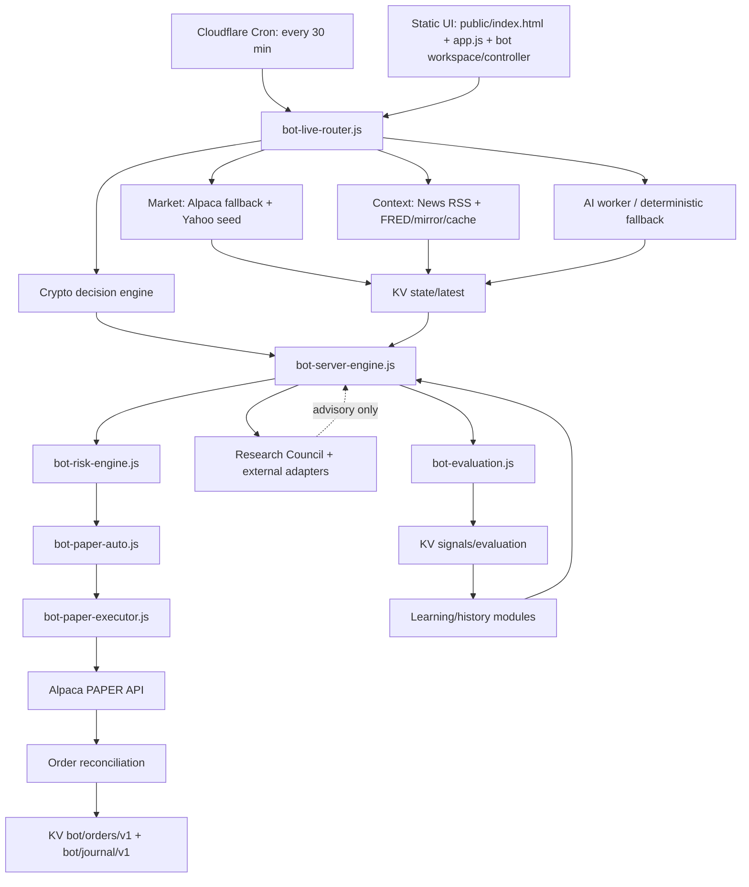

# Miracolo Lab — architecture and pipeline audit

Audit scope: branch `feature/research-council-advisory`, read-only code review plus CI contract checks. No production deployment and no live trading.

## Runtime map

## Canonical vs overlapping components

| Component | Role | Audit assessment |
|---|---|---|
| `bot-live-router.js` | Cloudflare entry point, cron orchestration, API routes | Canonical runtime |
| `bot-server-engine.js` | Builds module votes, consensus, risk approval, advisory research payload | Canonical decision engine |
| `bot-risk-engine.js` | Deterministic risk gate | Single risk gate identified in server path |
| `bot-paper-auto.js` | Converts approved decision into PAPER action | Execution orchestration |
| `bot-paper-executor.js` | Alpaca PAPER order submission | Provider boundary |
| `bot-crypto-engine.js` | Crypto signal/position logic | Separate domain engine, must converge on shared execution safeguards |
| `bot-evaluation.js` | Signals, horizons, outcomes and reports | Evaluation/learning data path |
| `bot-research-council.js`, `bot-ai-research.js`, `bot-research-adapters.js` | Alternative analyses and frameworks | Advisory/research; should not independently authorize orders |
| `public/bot-pipeline.js`, `public/bot-decision-core.js` | Browser-side votes/technical calculations | Potential parallel implementation; verify call sites before removal |
| `live-worker.js` | Older/alternate worker runtime | Potential legacy/parallel runtime; verify route/deployment references |
| `jesse-lab/` | Separate experimental Jesse interface/worker | Isolated lab; not presumed part of canonical production pipeline |
| `public/v1/runtime-core/bridge/hotfix/compat` | Browser runtime compatibility layers | Multiple layers increase ordering/collision risk; consolidate only after call-site and behavior tests |

## Decision contributors

The server consensus currently assembles these families:
1. market
2. news
3. macro
4. technical
5. flow
6. AI
7. historical
8. backtest
9. learning
10. memory
11. crypto

Research Council, Vibe Trading, AI Hedge Fund, Daily Stock Analysis, Day Trader Skill, Financial Tool Use Planner, Freqtrade-inspired evaluator and LLM Trading Lab-inspired evaluator are separate research/evaluation outputs. They should remain non-voting unless explicitly promoted through a tested, versioned consensus change.

## Findings

### P1 — Scheduled execution is enabled by configuration
`wrangler.toml` currently sets `PAPER_AUTO_EXECUTION = "true"`, `PAPER_NOTIONAL = "100"`, `PAPER_MAX_BUYS_PER_DAY = "3"`, and a 30-minute cron. This is PAPER-only by endpoint validation, but it means automatic paper orders can be submitted on schedule. Keep this explicit in the UI/status and provide a clear kill switch.

### P1 — Reconciliation is bounded
The current sync requests the latest 100 Alpaca orders and merges matching audit/journal rows. It is not yet a cursor-based exhaustive reconciliation and cannot guarantee recovery of older missed events. KV write failures are surfaced in logs/phase errors but need user-visible operational alerting.

### P1 — Daily cap is journal-dependent
The daily order cap counts journal entries. If KV is stale, unavailable, or the journal has not yet reconciled, this count can understate orders. A stronger cap should combine Alpaca order history with a durable daily counter/atomic reservation strategy where available.

### P2 — Research duplication / correlated evidence
Many research adapters interpret the same canonical modules. They add perspective, not independent data. Avoid counting each adapter as a separate vote; otherwise the same market/news evidence may be double-counted.

### P2 — Frontend/server parallel logic
Browser-side decision helpers and server consensus coexist. The server must remain authoritative for risk and execution. Browser calculations should be labeled as previews and contract-tested against server outputs where they claim equivalence.

### P2 — Runtime compatibility layers
The UI loads compatibility, app, hotfix, runtime-core, runtime-bridge and other modules in a fixed sequence. This is fragile and creates possible global/function override collisions. Need browser smoke tests and a gradual module consolidation, not a blind deletion.

### P2 — Data provenance and freshness
Market, RSS, FRED, AI and cached fallback data have different freshness guarantees. The pipeline should carry per-source `observedAt`, `ageMs`, `source`, `isFallback`, `quality` and block or reduce confidence for stale critical inputs.

### P2 — Order state vs trade outcome
Order submission, fill, position, and realized P&L are distinct events. The journal/evaluator must only mark a trade completed after reconciled fills and should handle partial fills, cancel/reject, replace, and close-position events idempotently.

## Test plan

- CI syntax and existing decision/risk/crypto/news/UI contracts: executed through GitHub Actions.
- PAPER order lifecycle: add deterministic fixtures for accepted, partial fill, fill, cancel, reject, missing audit row, and repeated reconciliation.
- Risk: boundary tests for daily count, max positions, existing orders, missing price, stale inputs, and event-risk blocks.
- Data: empty/stale/cache-only/mixed provider cases; verify no synthetic data is mislabeled as live.
- UI: empty state, loading, error, stale/cache banner, order submitted, partial fill, filled, rejected, and kill-switch status.
- End-to-end: mocked Alpaca + KV, no credentials and no external order submission; scheduled pipeline should produce traceable phase output.

## Safety boundary

All current changes and tests are on the feature branch. No deploy performed. Alpaca PAPER only; no live endpoint or live order used in this audit.
